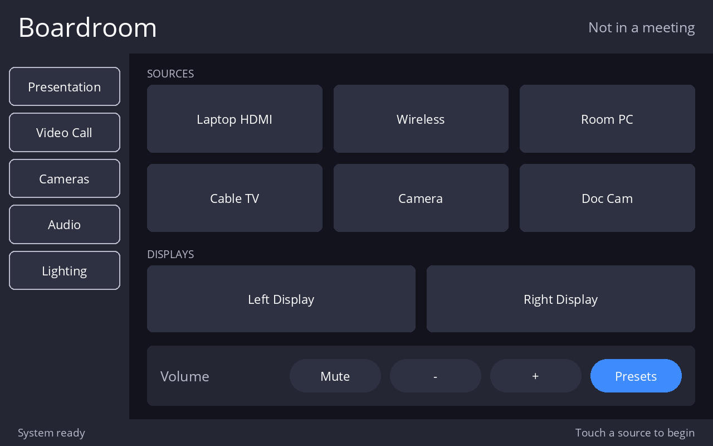

# Building a panel from scratch

Can you design an Extron touch panel as an artifact — a spec, a mockup, a
generated layout — and turn it into a real `.gdl` that GUI Designer opens and
builds? Yes, and this is how.

**Short version.** The design space is wide. *Build owns the artwork* is real,
but: the canvas is set by the panel model rather than fixed, lines can be
diagonal, ~339 icons are
available as font glyphs needing no image resource, new border resources can be
appended (§5), and Extron ships per-panel `.glt` template libraries to clone from.
`docs/design-rules.md` holds Extron's own rules, separated from what we guessed.

## 1. What actually bounds the design space

An authored control carries `TLPImageID = -1`. It has no artwork. What it has is
a fill color, a stroke color, and a **named** border resource that supplies
the silhouette. GUI Designer rasterizes those on Build. So a generator never
makes pixels; it names resources and sets colors.

The obvious reading of that is that a
generator is limited to the seven border resources the shipped panel references.
That reading is wrong. `gdl/project.py`'s `border_resources()` enumerates
`PBResourceReferenceBorder`, which is *bindings in use*, not definitions. The
definitions live in `PBProject.resourceSetField`, and there are far more of them:

| Class | Count in `_alt 2_0_0` |
|---|---|
| `PBBorderResource` | **34** |
| `PBImageResource` | 38 |
| `PBFontResource` | 4 |

Of the 34 borders, 28 are System-authored (`authorField = 0`) templates and 6
are the User-authored `Afterburn - *` ones. Read out of their `dataField`
(`PBBorderInfo`), the parametric vocabulary is:

| | values present |
|---|---|
| shape | rectangle family (1), ellipse (2) |
| style | 2D flat (0), 3D beveled (1) |
| corner radius | 0, 5, 10, 14, 999, 9999 (9999 = capsule) |
| thickness | 0, 1, 2, 3 |
| 3D lighting | `depth`, `surfaceHeight` (3, 78, 117) |

The six Afterburn resources are **not** clones of the System templates, which
is more interesting than if they were. Every one carries `style = 0` (2D flat)
together with `depth = 1, surfaceHeight = 3` (the 3D lighting values) — and no
System template has that combination: every System `style = 0` record has
`depth = 0, surface = 0`, and every record with `depth = 1, surface = 3` has
`style = 1`.

So a human, working in GUI Designer's own UI, produced border resources with
parameter combinations that ship with no template. §5 confirms the stronger
version: a **hand-appended** resource with out-of-corpus values also survives a
build, and rasterizes at the geometry it asks for.

**The consequence that matters:** a generator that only *references* resources
already in a donor project needs no new resource appended.

Worth knowing how narrow the corpus evidence was: across all six fixtures only
**9** distinct border names are ever bound to a control, and ~25 — including
*every* 3D template and every `zGD - Default *` — are defined but never
referenced. §5 tested one of those unreferenced names directly and it built
clean, so the usable palette is the full **34**, and appending more works too.

## 2. What is free, what is bounded, what is impossible

**Free.** Layout and hierarchy, page and popup structure, ID allocation, exact
fill/stroke/text color (any ARGB), typography within the embedded faces, and
which border resource each control uses — all 34, confirmed in §5.

**Bounded — less than expected.** Silhouette is
rectangle/rounded/capsule/ellipse × flat/3D. A new radius means a new resource,
and §5 showed appending one works, so this is bounded by the shape *family*
rather than by the resource list.

**Impossible without new resources, and possibly impossible at all.**

- `PBLine` cannot be **freehand or polyline**. Its `startPoint`/`endPoint` are an
  eight-value enum (TopLeft, TopCenter, TopRight, MiddleRight, BottomRight,
  BottomCenter, BottomLeft, MiddleLeft) plus start/end caps and thickness — so
  TopLeft→BottomRight *is* a diagonal, and since the bounding rect is arbitrary so
  is the angle.
- Canvas size is set by the panel model, **not fixed** — `docs/design-rules.md`
  §1 lists the resolutions. The fixtures are all 1280×800, which is a property
  of this client's hardware, not of the format.
- Arbitrary raster art: unless the bitmap is already a `PBImageResource` it needs
  the resource-append step (which §5 showed works). But note this is rarely the
  binding constraint — ~339 icons are available as *font glyphs* and need no image
  at all. See `docs/design-rules.md` §6.
- Gradients beyond what `depth`/`surfaceHeight`/`lightAngle`/`lightBrightness`
  produce.

## 3. The pipeline, and what exists today

| Stage | State |
|---|---|
| Brief → spec | **By hand**, following `SKILL.md`. `examples/huddle.json` and `examples/huddle-functions.json` were written from prose briefs. |
| Functions → the programmer's ID map | **Built and verified against a build.** `python -m gdl.idmap`, `docs/idmap.md`. |
| Layout pass | **Built.** `gdl/spec.py` `grid()` / `stack()`. |
| Control ID allocation | **Built.** Per-page bands, unique across the project, honors pinned ids. |
| Preview render | **Built.** Straight through `gdl/compose.py`. |
| Spec → build plan | **Built.** `python -m gdl.spec plan`. |
| Plan → `ProjectGCP` | **Built and verified.** `powershell/Apply-GdlPlan.ps1`; `-WhatIf` dry-runs it. |
| Repack to `.gdl` | Built already — `gdl/container.py pack`. |
| GUI Designer opens + builds | **Verified**, and scriptable from the host (§7). |

Popup groups need nothing more: `Register-GdlPopupGroup` is a complete
implementation of the only group concept the format has — a class census of the
corpus's 47 projects finds 58 `PBControlGroup` instances, from none to five a
project, and every one an entry of its project's popup group registry
(`popupPageGroupsField`): a seed's one, where it has any (`Controls`,
`Transport1`, `inputs`, `Room Controls`), as much as the client's four or five.

It makes a group by cloning one of the registry's own, so a project with none -
the 320 and 300M seeds and one client fixture - cannot take a grouped standard
popup: `gdl.spec donors` refuses it, and the function stops with that reason
rather than on an index out of range. A plan problem (a control with no donor
to clone, an op that threw, a popup binding that did not take, a start page the
plan does not author) stops `Apply-GdlPlan.ps1` from writing the file, as
`Apply-GdlEdits.ps1` already stopped.

## 4. The preview is the point

Building is the slow step — apply, pack, open, Save and Build, verify. The
compositor is scored against GUI Designer's own snapshot exports
(`tests/baseline.json`), which makes it good enough to judge a design *before*
building it:

```bash
python -m gdl.spec check  examples/panel.json     # ids, off-canvas, sizes, unknown resources
python -m gdl.spec render examples/panel.json out/preview.png
python -m gdl.spec plan   examples/panel.json out/plan.json --donor "seeds/Afterburn 1035.gdl"   # ops for the applier
```



That image is a panel that has never existed: 28 controls, every rect computed
by the layout pass, every id allocated, rendered by the same code path that is
measured against ground truth. §5b shows the same spec after GUI Designer has
actually built it, which is the proof; this is the cheap check you run first.

The preview is honest about what it is drawing: every control is emitted with
`TLPImageID = -1`, exactly as an authored control is before Build, so the
preview draws from the same fill-plus-named-border properties a writer would
set.

## 5. Tested against GUI Designer 1.28.0.7 — results

Each test project was authored **headlessly** by PowerShell, packed with
`gdl.container pack`, then opened and built in the real application. See §7 for
how that was driven, which is fully scriptable.

The error and warning counts below were read off 1.27.0.9. On 1.28.0.7 the
format probes (`examples/probes-128/`) built all three of `New-FormatProbes.ps1`'s
tests again from the same fixture, each with a payload: test 1's control still
on `3D Capsule`; test 2's 35 border resources against the fixture's 34, the new
one defined, bound and at radius 20 and thickness 1; test 4's page holding the
clone (10 controls built to 11). 1.28 shows no count to read: its Build Manager
is a progress bar, the phase it is in and Cancel, and closes itself when a build
succeeds (§7). So "0 errors, 0 warnings" is the 1.27 measurement, and a payload
that `tests/verify_built.py` holds to its plan the 1.28 one. The probes' record
is `archive/job-e823df9b/probes-128/`.

| | Question | Answer |
|---|---|---|
| 1 | Reference an existing but never-referenced border resource? | **YES** |
| 2 | Append a *new* `PBBorderResource` and bind to it? | **YES** |
| 3 | Out-of-corpus `PBBorderInfo` values? | **YES** — builds, and rasterizes as asked |
| 4 | Cross-graph `Copy-GdlObject`? | **YES** |
| 5 | ID / name uniqueness enforcement | **NAMES yes, hard error**; duplicate ids are legal to GUI Designer (`gdl.spec` refuses a repeat on one page but a mirror inside its control - Shockwave's tab twin, built on the 1035 and the 1535) |
| 6 | `referenceCountField` semantics | **none the panel sees** — Build keeps it as written |

**1 — referencing an unused resource works.** A `PBShape` was repointed from
`Afterburn - 10 Radius 0 Thick` to `3D Capsule`, a System template no control in
any fixture binds. GUI Designer opened it and built with **0 errors, 0
warnings**. So §1's conclusion holds: the usable palette is all **34** defined
resources, not the 6 this project happens to reference.

**2 — appending a new resource works, so the design space is fully
parametric.** A `PBBorderResource` was cloned, renamed
`Claude - 20 Radius 1 Thick`, given `cornerRadius = 20` and `thickness = 1`
(a combination present nowhere in the corpus), appended to
`resourceSetField.resourcesField` with `.Add()`, and bound to a control. It
opened, built with 0 errors, and the new resource **survived into the built
file** — still present, still bound, verified afterwards with `gdl/project.py`.

This was the biggest open question and it is the more permissive answer: a
generator is not limited to a donor's existing resources.

**3 — a border no template defines rasterizes as asked.** Five resources
appended to the Afterburn 1035 seed at radius and thickness 20/1, 40/6, 0/12,
60/3 and 100/9 - none in the corpus - and the seed's own 10/2 beside them, each
on a filled and stroked 360x260 panel, built and verified clean. Each stroke is
its thickness exactly off the built artwork, and each panel differs from
`gdl.compose`'s drawing of the same geometry on 0.0% to 3.2% of its pixels, the
corpus's own 0.1%. What differs is the corners: Build's arc is a little rounder
than a circle of the radius - along the diagonal its stroke starts up to 2 px
further in than the preview's and ends up to 3 px further in at radius 100,
1 px at the corpus's own radius 10 - so the preview's corners are slightly
tight on a large radius (`docs/ROADMAP.md`). So `gdl.spec` building a border the donor lacks as
its nearest (`nearest_border`) is a choice, not a safety rule: a resource
appended at the asked geometry would build as asked, and the applier does not
append one yet.

**4 — cross-graph cloning works.** A control was cloned out of one
independently-deserialized project into another with `Copy-GdlObject`, and the
result opened, built clean, and rendered correctly (the cloned popup reference
paints its group member, per render finding 3). A curated component library in a
separate `.gdl` is therefore viable.

**5 — page and popup names must be unique project-wide.** Found the expensive
way. The worked example's two popups were named `2210 - Conference Volume` and
`2220 - CATV Volume` — perfectly sensible names, and unique *within the spec*.
But a generated panel joins the **donor's** project, and the client donor
already had both. Build rejected it:

    2210 - Conference Volume   Duplicate page or popup page names are not
                               allowed within the same project.
    2220 - CATV Volume         Duplicate page or popup page names are not
                               allowed within the same project.

Two errors, no payload. Points worth keeping:

* Pages and popups share **one** namespace — a popup may not take a page's name.
* It is a **build** error, not a load error. GUI Designer opened the file
  happily and showed both duplicates in the workspace tree, so "it opens" says
  nothing here.
* The **name** is the only identity that matters. Page "number" (the `2210 -`
  prefix) is a naming convention, not a field: `PBPage` has no number, and the
  fixture's own names are just numerically prefixed strings.
* Numeric `idField`s were duplicated across projects throughout this work with
  no complaint, so whatever uniqueness ids need, it is not this one.

`Panel.check_donor()` compares spec names against the donor's before anything
is built, and `Panel.check()` catches a spec that collides with itself. Renaming to `2310 - Program Volume` / `2320 - Speech Volume` cleared it:
the build emitted `generated9.tgz4` with 207 PNGs (a failed build emits none),
661 of 698 controls rasterized, and both popups came through with their own
captions.

**And the file was still wrong** — see the next finding, which is the more
important one.

**A control that does not fit its page is moved to 0,0. Silently, at build
time, with the build still reporting success.** The clean build above was
checked by rendering it, and one button was missing from each popup. Reading the
built `layout.json` back:

    2310 - Program Volume  (page is 915x800)
        Mute     256,24  164x60
        -        436,24  164x60
        +        616,24  164x60
        Presets    0,0   164x60     <- planned 796,24

Every relocated control is exactly one whose right edge passed **915** — the
donor popup's width. The applier sized nothing, so each cloned popup kept the
donor's dimensions while the spec laid its controls out across 984. Note what
survived: the width and height are the planned ones, only the position was
rewritten, so the object is not corrupt and nothing in the file says it was
touched.

Consequences worth keeping:

* **A popup's size must be authored** (`widthField` / `heightField`; both
  `PBPage` and `PBPopupPage` carry them). A clone inherits the donor's, and the
  donor's is arbitrary.
* **"It built with 0 errors" is not a correctness check.** This is the second
  trap of this shape after `flattenText`, and both produced a file that opened,
  built and was wrong.
* So the loop now ends with `python tests/verify_built.py <plan.json>
  <built.gdl>`, which reads the plan and the built file and asserts every
  authored control's rect and caption. It reproduces this defect exactly and
  reports 0 problems on the fixed build.

**What Build adds by itself.** The generated page came back with 35 controls
against 29 authored, which looked like clone contamination and is not: Build
adds one full-canvas `PBPopupPageReference` per **modal** popup to **every**
page, the Offline Page counting only when `EnableOfflinePage` is on — and that
build kept the donor's pages, which brought seven modal popups, one of them a
switched-off Offline Page. The applier now drops the donor's own pages and
popups (§5c), so a page gets one reference per modal the spec names. The
verifier allows a full-canvas popup reference, which is what those are, and
fails a page or popup carrying any other control its plan did not author.

**6 — `referenceCountField` reaches nothing Build makes.** Three popup groups
of 1, 3 and 5 popups, each shown by one reference, were built from a spec - the
applier writes 2 on each - then rewritten to 46, 0 and 1 and built again. Build
kept 2, 2 and 2 the first time and 46, 0 and 1 the second, neither the groups'
popups nor their references, and the second panel's `layout.json` and artwork
are the first's bar the file's name, checksum and version stamps;
`tests/verify_built.py` held both builds to the plan with 0 problems. So the
count is GUI Designer's own bookkeeping, kept through open, Save and Build, and
the panel never sees it: the applier's 2 is as good as any.
`tests/audit_corpus.py` says what the corpus holds (`docs/gdl-format.md` §9).

`Project > Verify` is not the build, and `BuildProject()` cannot be called
headlessly — `docs/gdl-format.md` §2 has both. §7 is how the real build is
driven.

## 5b. The whole loop, closed

`examples/panel.json` was taken end to end:

    spec -> layout pass + ID allocation -> build plan -> Apply-GdlPlan.ps1
         -> ProjectGCP -> gdl.container pack -> GUI Designer -> Save and Build

Built on `seeds/Afterburn 1035.gdl` by `New-GdlPanel.ps1`, unattended and
with the seed's own pages kept - as every build was before §5c's real-size
panel - it verified with 0 problems: a page of 47 controls - the spec's 29, and
the popup reference Build adds for each of the seed's 18 modal popups - 28 of
them carrying rasterized artwork. `docs/generated-built.png` is that page rendered from GUI
Designer's *own* built payload, not a preview. Its volume row shows the first
popup of the spec's `Volume` group, `2310 - Program Volume`, over the page's
own label, as GUI Designer's snapshot does; the preview above draws the page
alone:


Every rect came from `grid()`/`stack()`, every id from the allocator, every
caption from the spec.

Three defects had to be fixed along the way, all of them the same shape - a
clone inherits things you did not ask for:

1. **The page kept the donor's page-level artwork**, which painted underneath
   everything. Clear `<TLPImageID>` on the cloned page.
2. **Buttons kept the donor's icon.** Clear `buttonImageField`.
3. **`flattenText` bakes the caption INTO the artwork at build time**, and the
   clone inherited it - so Build deduplicated all five nav buttons to a single
   asset carrying the donor's word "Audio", with the correct captions sitting
   unused in `layout.json`. Set `flattenTextField = false` and Build leaves the
   captions to `layout.json`, for the panel to draw live as it does for
   hand-authored panels - expected, not observed here (`docs/gdl-format.md`
   §2).

That third one is worth remembering: the file was *correct* the whole time -
`layout.json` had the right text - and only the rendered artwork was wrong.
Checking the model would have said everything was fine.

Color is checked the same way, off the *built artwork* rather than the model,
because a built control's `BackgroundFillColor` reads back transparent white
whatever was authored. On this panel 21 of 21 planned fills are the plurality
color of their own rasterized asset — the accent button at 87% `#3D8BFD` — and
the page artwork is 100% `#12131C`, with no trace of the donor's.
`tests/verify_built.py` makes that a gate on every build.

## 5c. Authoring without a client project: seeds

Before the seeds, every generated panel cloned
`fixtures/gdl/client-boardroom-2.0.0.gdl`, which is a **real client project**.
That is fine for testing and wrong for delivery: the result inherits that
client's page names, popups, resources, artwork and retail fonts, and is
pinned to their model and theme.

The obvious fix is to clone one of Extron's own templates instead. There are 50
of them under `GUI Designer Templates\TouchLink Templates` in the shared
Documents folder, they are the same `KP`-swapped container, `Project.open()`
reads all 50, and they cover six theme families across Extron's panel sizes.
(1.28 added six: Afterburn, Mach and Shockwave each gained an ECP 16-9 and an
ECP 16-10 variant. They are new sizes inside existing families, not a seventh
family.)

**It does not work, and it fails quietly.** Measured against
`Afterburn 1020 Series.glt`:

- `gdl.spec donors` was happy — every control type resolved.
- `Apply-GdlPlan.ps1` applied all 16 ops and wrote a 3.4 MB ProjectGCP.
- `gdl.container pack` produced a 1.7 MB `.gdl`.
- GUI Designer opened **empty** and showed the Project Create Wizard.

A `.glt` has no `PBProject`. It is a library of pages, popups and resources with
no project wrapper, so there is nothing for GUI Designer to open and it offers to
make a new project instead. From outside, that is indistinguishable from a hang —
the pipeline waited its full 180s for a window title that was never coming.
`Panel.check_donor` now catches this in about a second, and `New-GdlPanel.ps1`
says what a missing window probably means.

`pack()` no longer requires a payload member, which is worth keeping on its own:
a `.glt` has none, and neither does a `.gdl` saved without building. The result is
a ProjectGCP-only container, which GUI Designer opens and builds happily — the
payload is Build's *output*, not its input.

### Making a seed

The project wrapper has to come from GUI Designer. `PBProject` cannot be
constructed headlessly any more than a `PBPage` can, and a template has none to
clone - saving one as a `.gdl` in feature-flag mode keeps it a template (§7
*Feature-flag mode*).

So, once per theme:

1. **File > New Project...**
2. Step 1, pick the panel — ideally the size you will deliver on (see below).
   A panel that rotates shows a **Resolution**, `(Landscape)` or `(Portrait)`;
   Theme is offered only where a template is drawn that way up
   (`docs/design-rules.md` §1).
3. Step 2, choose **Theme**, then the theme, project font and application.
4. **Create**, then save it into `seeds/`. That file is the seed.

Then pass `-Donor "seeds/<seed>.gdl"`, and nothing of anyone else's is in the
output.

`seeds/` holds Afterburn, Mach, Shockwave, Turbulence and Zoom Rooms seeds at
the TouchLink sizes, the 835 seed below, and every themable Extron Control Pro
combination. `seeds/README.md` lists each one's model, canvas and resources. They
are in Git LFS, so run `git lfs pull` on a fresh clone.

**Prefer a seed at the target size; retarget is the fallback.** A retarget
builds correctly — 654/654 on the client fixture, 650/650 on the Afterburn
1035 seed taken to a 1535M. But scored against Extron's *own*
hand-authored 1535, only 22% of controls land identically, median 18px off. The
rule is the same per-axis scale Extron used; the difference is their designers
nudging by hand, which a native-size seed carries and a retarget cannot. See
`docs/editing.md`.

### A seed works, end to end

Against a seed made by hand in about a minute (File > New Project, Afterburn
All-inclusive 1220 theme, TLP Pro 835M), now `seeds/Afterburn 835 (Project1).gdl`,
`examples/multipage.json` went through `New-GdlPanel.ps1` unattended:
three pages, 39 authored controls, **built and verified with 0 problems**, and
nothing of any client's in the result.

Two things that seed taught, both now checked by `gdl.spec donors`:

- **A fresh themed project defines a different resource set from a client
  file.** It has 31 border resources and the fixture has 34, but they are not
  the same list. And its only font resources are Arial, Extron-Afterburn and
  Open Sans - so the spec's `Forma DJR Display`, inherited from the client
  fixture, had no resource to resolve against. That does *not* fail the build:
  `Set-GdlFont` correctly leaves the donor's face, the panel builds clean, and
  it ships in Open Sans. Only `tests/verify_built.py` noticed, 14 controls deep.
- **The spec's `model` is not the panel's model.** The built panel is whatever
  the donor is - this seed is an 835M: its platform and skin are the donor's,
  and the applier never touches them. So `donors` refuses a donor whose canvas,
  part number or theme is not the spec's `size`, `model` and `family`; the
  1035T and 1035M share a part number, and so share a donor.

### A real-size panel

`examples/boardroom-full.json` is the size of a real job - the client project
has 27 pages - built on `seeds/Afterburn 1035.gdl`: 23 pages reached from a
Welcome start page, a page per source, room pages, three video-call pages and
help; a Volume popup group shown on seven pages, each through its own popup
reference; a Keypad group in a different place on each of two pages; three
modals, two of them shown by the program; and Home, the status line, Room Off
and the volume tabs mirrored under one ID each on every page that carries them.
`New-GdlPanel.ps1 -IdMap` builds it unattended, and the build verifies: its 367
controls - 336 on the pages, 31 in the six popups - and 378 ID-map references,
0 problems.

Getting there found these, each fixed, checked or measured:

- **A grid's `rows` were ignored and its extra items dropped.** A `grid` given
  `rows` and no `cols` laid every item in one row, and a grid or stack with
  more items than cells dropped the rest - silently, unless a cell came out too
  small to touch.
- **The donor's own pages and popups shipped with the panel.** The seed's 7
  pages and 29 popups sat beside the spec's, unreachable from its start page,
  16 of their controls on 13 IDs the spec's own carry. The applier now drops
  every page and popup it did not make itself - by identity, so a spec may use
  a name the donor does - keeping GUI Designer's Offline Page, the 29th popup
  (`"keep_donor_pages": true` keeps them all); `tests/verify_built.py` fails a
  panel carrying a page or popup its plan does not name. The built file went
  from 3.66 MB to 2.89. Only the pages and popups go: the donor's resource
  library ships whole.
- **Save and Build is slow, and its time varies.** Six builds of the spec ran
  on one host. The five that ran to the end took 21 minutes with the donor's
  content, then 28, 9, 21 and 22 without it - so the donor's content is not
  what decides it (`docs/ROADMAP.md`, *What a real-size build spends its time
  on*). The fourth was closed after a minute by a
  wait that took it for wedged.
- **A small spec's build is the seed's content.** `examples/panel.json` - one
  page, 29 controls - built on the same seed in about a minute with the seed's
  pages and popups dropped, and in about 11 minutes with them kept: 71 s
  against 643 s from the click to the file written. The seed's 7 pages and 29
  popups are nearly all of a one-page panel's build, and less than the spread
  between two builds of the 23-page one.
- **A fixed wait called a running build failed.** `Wait-GdlBuild.ps1` gave up
  at 15 minutes while GUI Designer was still building; it now runs on while
  GUI Designer is still busy (§7). The Build Manager is no sign of life: in
  the build watched to its end it appeared only 20 minutes in, for the last 25
  seconds before the save.

The logs of all six builds, the window watcher's log, the last build's plan,
ID map and built file, and the donor-kept build's file are in
`archive/job-2419a20b/item4/`; the one-page panel's two builds are
`archive/job-2419a20b/autoseed/` (dropped) and `wait/long-build.log` (kept).

### Automating the wizard: it works in 1.28

**This changed in 1.28 and the old advice here was "it exposes no UIA providers
at all".** That is no longer true. The wizard's descendant tree is now populated:
the Panel Type, Theme and Application combo boxes expose `Value` and
`ExpandCollapse`, the dropdown's items expose `Invoke`, `SelectionItem` and
`ScrollItem`, and expanding Panel Type enumerates all 56 entries ("Select Your
Panel" plus the 55 models) — which is a convenient way to read the shipped panel
list without reflecting over the assemblies.

**It can be driven end to end.** All six `seeds/*ECP*.gdl` were made this way,
with no hands on the mouse. The working sequence is the plain one
— for each combo in turn, click it to expand, then click the list item you want:

1. Panel Type. Expanding it lists 56 entries ("Select Your Panel" plus the 55
   models), which is also a convenient way to read the shipped panel list.
2. For a soft client, or a panel that rotates (`docs/design-rules.md` §1), a
   **Resolution** combo appears once the panel is chosen. Choose it before step
   3: what Theme offers depends on it.
3. Step 2's Blank / Theme radios, then Theme, then Application.
4. Create.

**Click the Blank/Theme radio yourself, and verify it took.** Step 2's Theme and
Application combos populate on their own as soon as a themable resolution is
chosen, so the wizard can read `Theme: Mach` while `Blank` is still the selected
radio — and Create is enabled either way. Two seeds were built blank before this
was noticed. The radios are `Pane` elements with no toggle state to read back, so
the only checks are a screenshot before Create, or the page count after: a blank
ECP project has 1 page, 1 popup and 3 controls against a themed one's 7-8 pages
and 500-650 controls.

**Do not set a combo by value.** `ValuePattern.SetValue` writes the edit text
without raising the selection, so the combo *reads* "Extron Control Pro" while
the preview still says "No Panel Type Selected", Step 2 stays greyed and Create
stays disabled. Worse, it desynchronises the control from the model: nothing
afterwards commits, the wizard's own accessibility subtree stops responding
(`FindAll` throws `Operation timed out (0x80131505)`), and the only way out is
Cancel. `SelectionItemPattern.Select()` is the same trap — it highlights without
committing. Only a real click on the list item works.

`Create` and `Cancel` expose no patterns, so they need a click by position.

**`powershell/New-GdlSeed.ps1` does all of this**, and turns a rotating panel
with `-Resolution 'WxH'` before the theme. It refuses a name the wizard does not
offer, and a disabled Theme radio, as for a portrait 835M. It builds what it
saves, since Save As writes no `layout.json` and every hand-made seed is built,
and runs `tests/verify_seed.py` on it, removing the
file if it does not build or the verifier refuses it or cannot run, so a seed
nobody verified never stays where the next run finds it; a Save As that never
finishes leaves no file either. The verifier checks the theme and part number,
that the project is a themed one and not a Blank one, and that its pages are
those of the series template GUI Designer takes for the model: a built seed
names no series, but its pages are the template's (`docs/gdl-format.md` §7). It
saves a screenshot of the wizard before Create - the Theme radio shows no state -
to the job's `tmp` folder when `CLAUDE_JOB_DIR` is set, else the temp folder, and
prints where. `-Output` is relative to where the shell is, or absolute. It
closes any GUI Designer already running, unsaved work and all, and says so
first. Three more things it had to learn, for anything else that drives the
wizard:

- **Wait for GUI Designer's own wizard.** It opens one by itself once it has
  loaded: the main window appears in about a second, the wizard about ten
  seconds later. File > New Project in that gap opens a second wizard over the
  first, and UI Automation then reports a wizard with no combos, or hangs.
- **Search for a combo by type as well as name.** The text "Panel Type:" beside
  the combo is an element of the same name, earlier in the tree, and
  `Expand()` on it does nothing.
- **Save the new project with window messages, not UI Automation.** The File
  menu names the item after the project - "Save Afterburn All-inclusive 725
  As..." - and the dialog it opens, "Save Project As (<project>)", is the
  Windows common dialog. Opened by a UIA `Invoke`, it does not answer UIA in
  time: a walk of it takes minutes and finds neither its File name box nor its
  Save button. `WM_SETTEXT` into the File name box (the visible `Edit` in a
  `ComboBox` under `FloatNotifySink`) and `WM_COMMAND IDOK` to the dialog save
  it in seconds, with no mouse and no focus.

Two things that mislead on the way in. `InvokePattern.Invoke()` on the menu item
that opens the wizard throws `Operation timed out (0x80131505)` because the call
blocks on the modal — the dialog *does* open, so query it from a separate call
rather than believing the exception. And a click by position goes to whatever
window is on top, so raise the wizard first and confirm what is under the point
before clicking; otherwise it lands in your terminal and nothing appears to
happen.

One consequence worth stating plainly: a seed is no longer the step that needs a
person. It still needs GUI Designer running and a desktop to draw on.

## 6. Honest limits of everything above

- Test 3's border was measured on one theme's seed, at six geometries on
  360x260 panels; the preview's corners on a large radius are a few pixels
  tight (§5). The 1.28 Build Manager's readout of a *failed* build was not
  seen: every probe build succeeded, and a clean one shows no count (§7).
- The resource counts are from the `_alt 2_0_0` fixture, which carries 34 border
  resources; the two archived fixtures carry 36. Across Extron's 50 installed
  templates the count runs **13 to 32**, so treat it as per-project and read it,
  never assume it. The low end matters: a Mach or Turbulence template offers 13
  borders, so a radius/thickness the target project has no resource for builds
  as its nearest shape, and is refused where it has none near enough
  (`seeds/README.md`).
- The preview's fidelity to a build is measured, not inferred. `python
  tests/score.py preview <spec.json> <built.gdl> ...` draws each page and popup
  of a spec as the preview does and beside it the same one from the panel built
  from that spec, each alone. Over five panels - the borders probe in
  `archive/job-2419a20b/borders/` (three controls on a fully synthetic
  Afterburn 320 page) and round four's boardroom in regions on Shockwave's 1035
  and 525 and Turbulence's 1035 and 320 (`archive/job-e823df9b/round4/`), all
  built on GUI Designer 1.28.0.7, the four rooms on 2026-10-25 - 70 pages and
  popups, **0.57%** of pixels differ on average, median 0.02%, worst 15.85%.
  Nearly all of it is one thing: a level whose art the donor keeps
  (`keep_art`) is previewed as its bare bar; with every level and slider set
  aside, **0.21%**, median 0.01%, worst 1.39%, the rest corner geometry - a
  border Build takes as the donor's nearest radius, a window's edge.
  `archive/job-e823df9b/preview-score/` has the five specs, the command, the
  order of its pairs and the scorer's output page by page; the four rooms'
  builds are not archived. The panel draws its captions at runtime, in the
  faces its file embeds, and the scorer draws both sides in those faces: this
  measures the fills, borders, art and places the preview synthesises, and how
  true its text is is the render baseline's (`CLAUDE.md` *Verifying a
  change*). The preview alone knows no donor and draws a face as `gdl/fonts/`
  or a seed holds it (`gdl/fonts/README.md`); every caption of these five is
  Open Sans, which their builds embed as `gdl/fonts/` holds it.

## 7. Driving GUI Designer

This section is the one home for scripting GUI Designer; other files point
here. `powershell\New-GdlPanel.ps1` already runs the whole loop — check, donors,
plan, apply, pack, open, Save and Build, wait, verify — and exits 0 only if the
verifier passed. Read on to script anything it does not cover.

### The session it needs

Authoring — reading, cloning, editing and saving a project graph — is headless
and runs in any context. Anything that *draws* does not: GUI Designer and every
dialog it raises need a session where `[Environment]::UserInteractive` is true
and a desktop exists. A service, a scheduled task, or a remote exec that lands
as `nt authority\system` dies at the first form with "Showing a modal dialog box
or form when the application is not running in UserInteractive mode". An
ordinary logged-in session qualifies.

### The loop

```powershell
# 1. author. 32-bit PowerShell 5.1: .NET Framework still has BinaryFormatter,
#    and Extron's assemblies are x86.
C:\Windows\SysWOW64\WindowsPowerShell\v1.0\powershell.exe -NoProfile `
    -ExecutionPolicy Bypass -File examples\add-page-and-popup.ps1 `
    <work>\ProjectGCP <work>\new_ProjectGCP

# 2. repack, open it, and wait for the project window (see the title trap below)
python -m gdl.container pack template.gdl <work>\new_ProjectGCP <work>\x.gdl
Start-Process "$InstallDir\GUI Designer.exe" -ArgumentList '"<work>\x.gdl"'

# 3. Save and Build - take the baseline mtime BEFORE triggering it
$t0 = (Get-Item <work>\x.gdl).LastWriteTime
powershell\Invoke-GdlMenu.ps1 -Item 'Save and Build'
powershell\Wait-GdlBuild.ps1 -ProjectFile <work>\x.gdl -Since $t0
```

`$InstallDir` and `<work>` are `New-GdlPanel.ps1`'s `-InstallDir` (default
`C:\Program Files (x86)\Extron\GUI Designer`) and `-Work` (default a
per-project directory under `C:\gdlwork`). Keep `<work>` on a local disk: GUI
Designer is slow against a network or mounted drive, which is the only reason
the default is not inside the repo.

### What will cost you time

- **After any GUI Designer upgrade, clear the Save-and-Build prompt before
  expecting an unattended build.** GUI Designer's preferences live in a
  *per-version* `user.config`:

  ```
  %LOCALAPPDATA%\Extron\GUI_Designer.exe_Url_<hash>\<version>\user.config
  ```

  A new version gets a new folder, so every preference you had answered falls
  back to its default. The one that matters is *Automatically Remove Unused
  Resource Library Items During Save and Build*, whose default is to **ask**.
  The first Save and Build after an upgrade therefore opens a modal called
  **Save and Build Optimization** (Keep / Remove, plus "Don't show again") and
  waits. Nothing is built while it is up and GUI Designer sits idle, which from
  outside looks like a build that has not finished; the scripts stop at once
  and name it (the next item).

  The dialog's own controls expose **no UIA patterns**, so `Invoke-GdlMenu.ps1`
  cannot dismiss it; it is a coordinate click or nothing. Set the preference
  instead, with GUI Designer closed (it rewrites the file on exit):

  ```xml
  <setting name="ShowRemoveUnusedResourcesWarning" serializeAs="String">
      <value>False</value>          <!-- stop asking -->
  </setting>
  <setting name="RemoveUnusedResources" serializeAs="String">
      <value>False</value>          <!-- and Keep, not Remove -->
  </setting>
  ```

  Keep `RemoveUnusedResources` false. The shipped default is **true**, and
  answering "Remove" — or ticking "Don't show again" on that side — makes every
  later build silently strip unused Resource Library items, which is exactly the
  kind of invisible mutation `tests/verify_built.py` exists to catch.

  This is not a 1.28 feature; the preference is long-standing. It is an
  *upgrade* trap, and it will fire again on the next version.
- **A dialog that waits on a person ends a scripted run, saying which.**
  `GdlBlocker.ps1` names them: the upgrade prompt above; GUI Designer's
  **Application Licensing** window, which can ask for an Extron Insider login
  when it starts, with the user logged in, and opens nothing until someone
  answers it; and its own error boxes, whose message it reads out. From
  outside, each looks like slow work. The waits for GUI Designer to open a
  file, for the seed wizard and its new project, for that project's menu bar
  and Save As, and for the build ask on every poll and stop there - the build
  wait only with GUI Designer idle behind the dialog, as it is behind one that
  blocks, since a build may go on behind one that came up during it. A dialog
  a menu click raises is seen once `Invoke-GdlMenu.ps1` gives up on its
  blocked invoke, about a minute on. The login is the user's to give, never a
  script's, and what that window says is never read: it shows their e-mail
  address. A wait that runs out says what else GUI Designer is showing; its
  Project Create Wizard in place of a file is how it refused a `.glt` page
  library.
- **Trigger the build with `Invoke-GdlMenu.ps1`, not SendKeys.** UI Automation
  clicks the menu item directly and needs no focus, so the pipeline runs while
  the machine is in use - or while no one is looking at it, since a minimized
  Remote Desktop session holds no foreground window at all. The menu is
  expanded from a background job, a fresh PowerShell that takes seconds to
  start, and its items do not exist until it has, so the script polls for the
  item (`-MenuWaitSeconds`, 30 by default) rather than sleeping. SendKeys types into whatever holds the foreground, and a
  pipeline driven from a terminal can never take the foreground from that
  terminal. `Send-GdlKeys.ps1` is only the fallback, and it verifies the window
  and refuses rather than typing blind. `Invoke()` throws `Operation timed out
  (0x80131505)` because it blocks on the build modal; the click landed anyway,
  so watch the `.gdl`, not the exit code. It gives up 67 s after the click, and
  only then does `Wait-GdlBuild.ps1` start its clock, whose *finished* is 8 s
  after the write (the size held for 6 s at 2 s polls): from the click to the
  file written is its *rewritten* time plus about 68 s.
- **Wait by watching the `.gdl` itself, with `Wait-GdlBuild.ps1`.** Both obvious
  signals are wrong. The title's trailing `*` only means unsaved changes, so a
  freshly packed file opened clean never has one, and a wait on it returns at
  once onto the stale payload. The Build Manager window appears seconds *after*
  the click and closes *before* the file is written - from under a second to 35
  seconds before in the format probes' builds, the longer the larger the
  project, GUI Designer's *Wait...* window (*Please wait while the project is
  being saved*) standing between until a second or two after the write - so
  trusting it truncates the payload. The file's mtime is the real signal: wait
  for it to change, then to stop changing. How long to wait is whether GUI
  Designer is busy, and neither its writes nor its CPU alone says so. Idle, and
  with a modal waiting on a person, it writes a steady 3.5 KB/s at under 3% of
  a core - it never stops writing, so any write is no sign of life. A nine-minute
  build wrote 300 KB/s at 15% to 25% of a core for eight minutes, then for 90
  seconds wrote no more than idle at a full core, then saved. So busy is a
  tenth of a core or 32 KB/s, and the wait runs on past `-TimeoutSeconds` while
  GUI Designer is busy and gives up a minute after it goes idle, saying which it
  was. A 23-page panel built for 9 to 28 minutes, and a fixed 15-minute wait
  reported a failure while GUI Designer was still building. The measurements,
  on 1.28.0.7, are in `archive/job-2419a20b/wait/`.
- **The Build Manager has no count to read.** On 1.28 a clean build's Build
  Manager is a progress bar, the phase it is in (*Building Platform ...*, a
  page's name, *Building Modal Popup Page References ...*, *Validating Popup
  Page References ...*) and Cancel - no error or warning count - and it closes
  itself. `WM_GETTEXT` reads the phase; UI Automation reads no name in it. So a
  payload that `tests/verify_built.py` holds to its plan is the verdict, as it
  is anyway. The format probes' watcher saw the Build Manager so in ten of the
  eleven builds it watched (`archive/job-e823df9b/probes-128/`); none failed,
  so what a failed build shows on 1.28 is unread.
- **A build can run blind: leave it alone.** In the real-size build watched to
  its end (§5c), GUI Designer showed no Build Manager for 20 minutes - only for
  the last 25 seconds before the save - and the menu invoke's timeout looked
  like a click that missed; the build was running, and finished and verified
  clean. One closed as hung after a minute was lost. Its window stops answering
  for most of a build, too. Watch the process - its CPU and its writes
  (`Win32_Process`), as the wait does - not its window.
- **Take the baseline mtime before triggering, and pass it as `-Since`.**
  `Invoke-GdlMenu.ps1` blocks on the build modal, so when the build finishes
  before that call returns, a baseline sampled afterwards is already the
  post-build mtime, and the wait times out on a build that succeeded. Machine
  speed decides which way the race falls.
- **`Get-Process` caches `MainWindowTitle`.** It reads `GUI Designer` until you
  call `.Refresh()`, and only then shows `GUI Designer - [TLP Pro 1035T:
  x.gdl]`. Polling for the project name without refreshing waits forever.
- **`Responding = False` during a save is not a hang.** A *Please wait while the
  project is being saved* overlay is up, and the process reports it
  intermittently until the write finishes.
- **`Project > Verify` (Ctrl+B) is not a build**, and `PBProject.BuildProject()`
  cannot be called headlessly — `docs/gdl-format.md` §2 has both. The build is
  **File > Save and Build (Ctrl+Shift+B)**.
- **A seed is made by `New-GdlSeed.ps1`**, which drives the Project Create
  Wizard (§5c). Unlike a build it needs a desktop: in a locked or
  disconnected session the wizard's dropdowns never open, so it refuses. Two
  of its waits are long because GUI Designer is slow there, not stuck. Create
  builds the project behind a *Please Wait... Updating References* dialog,
  which for Mach's 1020 series outlasted a 180 s wait twice, and for
  Turbulence's 720 series a 15-minute one, with other work running - so it
  waits up to 30 minutes for the new project's title, and stops at once if
  GUI Designer closes. A panel type below the open list's rows - the TLP Pro
  1525TG's, near the end of it - is scrolled into view before it is clicked. And after Save As, GUI Designer stops
  answering for a while - 16 s for the Mach 725 seed, 34 s for the Shockwave
  and Turbulence ones - when UI Automation finds no menu in it, so it waits for
  an answer before Save and Build, says if none came, and tries that menu up to
  three times. A whole seed, Create to built file, takes from under two
  minutes to over twenty - by the seeds' own creation and revision times, 85
  to 168 s for the Afterburn 320, 525 and 725, and 560 to 1,337 s for the Mach,
  Shockwave and Turbulence 725s. The theme is not what decides it: the
  Afterburn 725, made again beside those three with feature-flag mode on and
  other work on the host, took 935 s (`docs/ROADMAP.md`, *What a real-size
  build spends its time on*). The 725 seeds' logs, the run that lost one to
  the hung window, and that Afterburn 725 are in `archive/job-2419a20b/seeds/`.
- **A seed the wizard cannot make is turned by `New-GdlTurnedSeed.ps1`** - a
  panel turned where its theme draws no template that way up. No wizard: it
  plans `gdl.edit retarget` on the model's own seed, applies it, then opens,
  builds, waits for and closes GUI Designer as `New-GdlPanel.ps1` does, and
  removes the seed if `tests/verify_seed.py` does not find it its series
  template turned.
- **Every panel of a canvas is built by `New-GdlPanels.ps1`** - one
  `New-GdlPanel.ps1` run per panel, as a child process each so one failure
  does not end the rest, strictly one after another: each run opens GUI
  Designer, builds and closes it, so two cannot share it.

### Feature-flag mode

GUI Designer has a feature-flag mode - a red status bar reading *Feature Flag
Mode* - that adds a **Debug** and a **Templates** menu and more properties.
What it shows on 1.28.0.7:

- **Debug > Feature Flag Control** lists the flags: Allow Hidden Devices, Show
  Cpu Memory Usage, Show Project Repair Option, Allow Internal Metrics, Gd Show
  Hidden Props, Gd Show Bezel Options, Gd Advance Page Options, Gd Enable
  Template Mode, Gd Allow Transparent Backgrounds, Gd Allow Editable Video
  Object Id, Gd Generate Checksum and Gd Allow Editable Image Object Id. *Allow
  Internal Metrics* lets a metrics service report usage; turn it off unless
  that is wanted.
- **Debug** also has *Set Project Screen Size* (Scale... or Don't Scale...),
  *Create Bezel* (a layout creator for hardware buttons, light bars and encoder
  knobs), three font-strip settings, *Edit Project Version*, and *Project
  Tree* - pages, popups, modal popups and popup groups with their names and
  ids, less than `gdl.project` reads. Bezel, font strip and project version
  have not been tried.
- **Debug > Set Project Screen Size > Scale...** is a plain per-axis scale of
  every page's controls, the one `gdl.edit retarget` makes: taking the Afterburn
  1535 seed to 1280x800 it matched that scale on 52 of 523 controls and was
  within a pixel on the rest (it truncates where `gdl.edit` rounds), left every
  font size alone, and scored the same against Extron's own 1035 layout. It
  cannot make a page larger than the panel's resolution: asked to, it raises an
  *Invalid Resize* modal per page and leaves the pages half-scaled, so never
  save the result.
- **Templates > Load GLT** opens a `.glt` as a project, titled with the panel
  GUI Designer gives it: `TLP Pro 1020T` for Mach 1020 Series, `TLP Pro 1035T`
  for Mach 1220 Series. Load a copy, read-only: the installed templates are
  what the wizard copies from. *Save As* a `.gdl` writes the template's own
  root, a `PBTemplate`, not a `PBProject`, and builds nothing - so it is not a
  seed, and `tests/verify_seed.py` refuses it.
- **Templates > Create GLT** opens the Template Manager on the open template:
  its series - the stored `mSeries`, which it labels `TLP1020` for
  `Series1020` and so on (`docs/gdl-format.md` §7) - resolution, style,
  applications - each a named subset of its pages - and common graphics.
- **Every installed template has one application** (the `.glt`'s
  `mApplications`): *All-inclusive* in the Afterburn, Mach, Shockwave and
  Turbulence templates, spelled three ways, and named for the product in the
  ZRTP, Teams Rooms and Zoom Rooms ones; the Zoom Rooms pair alone has App ID 1,
  the rest 0.
- **The Template Manager's series list** is TLP300, TLP320, TLP520, TLP535,
  TLP720, TLP835, TLP1020, TLP1035, TLP1220, TLP1230, TLP1520, TLP1720, TLI100,
  VTLPWeb, VTLPiOS and VTLPAndroid - every stored series but ECP's, in an order
  that is not the stored number's. No installed template's series is TLP835 or
  TLP1035: a 1220 Series template opens as a TLP Pro 1035T panel, but its series
  is TLP1220, which offers 1280x800 only - so Extron ships no portrait template
  for either.
- **Gd Show Hidden Props** adds an *Internal* category to a button (Press
  Feedback State ID, TLP Default State ID) and *Misc* fields: HidePressFeedback,
  HideVisualFeedback, HideTextFeedback, IsDynamicText, HwID, IsConfigurable,
  IsHardwareBased and Description; a page adds CustomImageUpload.
- **Gd Generate Checksum** leaves a plain save alone, but Save and Build with it
  on writes `PBProject.checksum`, and `layout.json` a `Checksum`: a CRC-64 of
  the project's metadata - application name and build, author, creation and
  revision times, version. Decompiled, GUI Designer.exe's Save and Build
  handler is its one writer, and nothing in the install reads it back. Every
  project built with the flag off reads 0 - every seed but those built with it
  on, which `seeds/README.md` names. `Apply-GdlPlan.ps1` clears it, so a panel
  built on one of those carries only the checksum its own build writes, if any;
  `tests/verify_seed.py` notes a seed that has one.

### Reading the screen back

```powershell
Add-Type -AssemblyName System.Windows.Forms,System.Drawing
$b = [System.Windows.Forms.Screen]::PrimaryScreen.Bounds
$bmp = New-Object System.Drawing.Bitmap $b.Width, $b.Height
[System.Drawing.Graphics]::FromImage($bmp).CopyFromScreen($b.Location, [System.Drawing.Point]::Empty, $b.Size)
$bmp.Save('shot.png', [System.Drawing.Imaging.ImageFormat]::Png)
```
